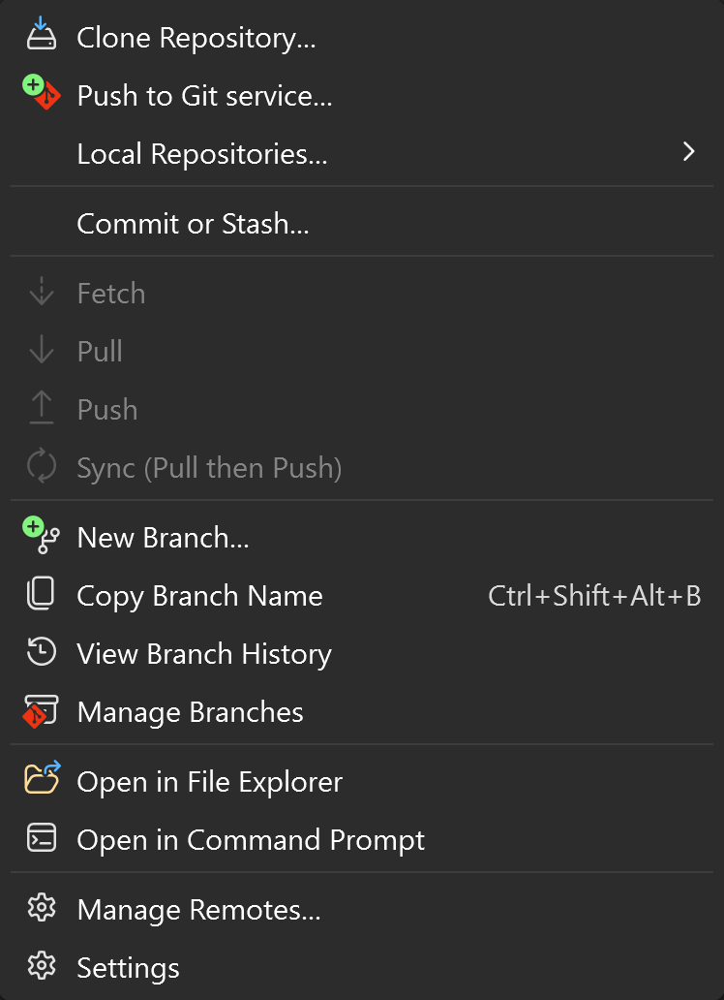
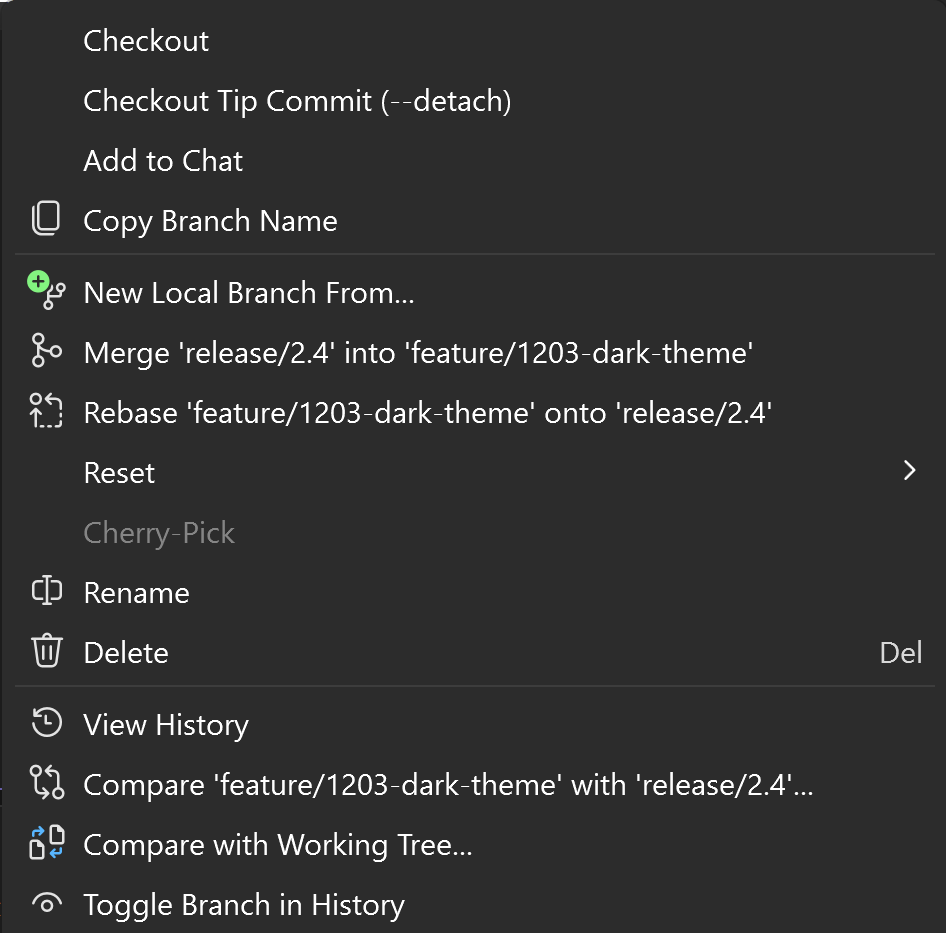

[marketplace]: <https://marketplace.visualstudio.com/items?itemName=aberus.CopyBranchName>
[vsixgallery]: <https://www.vsixgallery.com/extension/CopyBranchName.e3e0fab3-e833-45fe-9226-7cad2427e5a5>
[repo]: <https://github.com/aberus/CopyBranchName>
[suggestion]: <https://developercommunity.visualstudio.com/t/Copy-git-branch-name-to-clipboard/1555830>

# Copy Branch Name for Visual Studio

> **Help make this a built-in Visual Studio feature.** Visual Studio still can't copy a Git branch name on its own, which is the only reason this extension exists. Please **[vote for "Copy git branch name to clipboard"][suggestion]** on Developer Community so Microsoft builds it in.

[][vsixgallery]

Download this extension from the [Visual Studio Marketplace][marketplace]
or get the latest CI build from [Open VSIX Gallery][vsixgallery].

--------------------------------------

Pasting a branch name into a pull request, a ticket or a chat shouldn't mean retyping `feature/1203-dark-theme` by hand. Copy Branch Name puts the current Git branch on your clipboard with one click or **Ctrl+Shift+Alt+B** - and lets you copy any other branch straight from Visual Studio's branch lists.

## What You Get

**One shortcut** - Press **Ctrl+Shift+Alt+B** anywhere in Visual Studio to copy the current branch.

**Right where Git already lives** - *Copy Branch Name* sits next to *New Branch* and *Manage Branches* in the **Git** menu, in the **Git** submenu when you right-click in the editor or Solution Explorer, in the Git Changes window's **...** menu, and on document tabs next to *Copy Full Path*.

**Any branch, not just the current one** - Right-click a branch in the Git Repository window or in the branch picker to copy that branch's name.

**Multi-repository aware** - Copies the branch of the repository you're working in: the item selected in Solution Explorer, otherwise the active document, otherwise the solution.

**Out of the way** - The command only shows up while a Git repository is open.

## Copy Any Branch

Right-click a branch in the **Branches** pane of the Git Repository window, or in the branch picker you open from the status bar or the Git Changes window, and choose **Copy Branch Name**. Remote branches are copied as shown, for example `origin/feature/1203-dark-theme`.

## Keyboard Shortcut

| Action                       | Shortcut         | Command                         |
| ---------------------------- | ---------------- | ------------------------------- |
| Copy the current branch name | Ctrl+Shift+Alt+B | `CopyBranchName.CopyBranchName` |

Rebind it under **Tools > Options > Environment > Keyboard** by searching for `CopyBranchName`. The branch-row command is `CopyBranchName.CopySelectedBranchName` and has no default shortcut.

## Which Branch Gets Copied

The status bar confirms what was copied, for example *Copied Git branch name 'feature/1203-dark-theme' to the clipboard (Contoso.Web).* The repository is picked in this order:

1. With Solution Explorer (or another tool window) active - the repository of the **selected item**.
2. Otherwise - the repository of the **active document**.
3. Otherwise - the repository of the **open solution or folder**.

Special cases:

- **Rebase in progress** - copies the branch being rebased.
- **Detached HEAD** - copies the full commit SHA and says so in the status bar.
- **Worktrees and submodules** - supported.
- **Reftable repositories** - not supported; the status bar says so.

## How It Works

The current branch is read straight from the repository's `HEAD` file, so you always get the real branch name rather than Visual Studio's status-bar text, which can read *Checking out...* or *Multiple branches*.

Visual Studio doesn't tell extensions which branch row was right-clicked, so the branch-row entry reads the row under the mouse through internal Visual Studio members. If a future Visual Studio update changes them, that one menu entry disappears and everything else keeps working. To catch the very first right-click, the extension loads in the background once a repository is open.

Supports Visual Studio 2022 (17.0 and later) and Visual Studio 2026.

## Contribute

[Issues](https://github.com/aberus/CopyBranchName/issues), ideas, and pull requests are welcome.

Open `CopyBranchName.slnx` in Visual Studio with the *Visual Studio extension development* workload and press **F5** to debug the extension in the Experimental instance.
